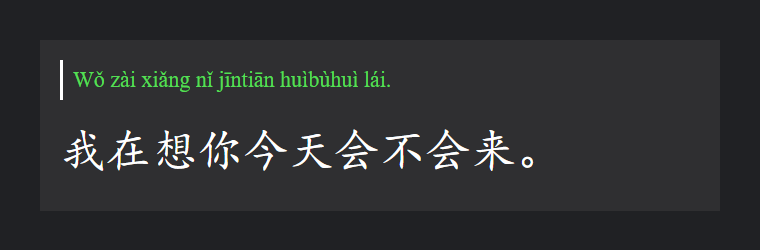
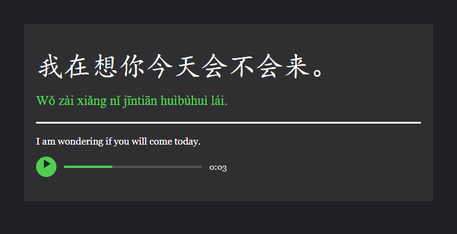

# Forkfed Chinese

**A corrected, audio-first Mandarin sentence deck for Anki — rebuilt from Spoonfed Chinese with accurate pinyin, tone sandhi, zhuyin, traditional characters, and a clean reading layout.**

[](https://apps.ankiweb.net/)
[](https://github.com/oatlayers/forkfed/releases/latest)
[](https://github.com/oatlayers/forkfed/actions/workflows/checks.yml)
[](#deck-at-a-glance)
[](#deck-at-a-glance)
[](LICENSE)

| Front — pinyin revealed | Back |
| :---: | :---: |
|  |  |

## What this is

Forkfed Chinese is a standalone Anki deck for learning Mandarin in context. It is a corrected rebuild of the classic [Spoonfed Chinese](https://ankiweb.net/shared/info/772959041) sentence deck: 7,326 audio-backed sentences in their original pedagogical order.

Each note is one sentence. The front shows Hanzi; hover (desktop) or tap (touch) to reveal pinyin. The back adds pinyin, the English translation, and the sentence audio.

The project is also a reproducible data pipeline: the deck is generated from the source APKG, with every pinyin correction, duplicate decision, and audio issue recorded in an audit trail.

## Why this fork

The source deck is excellent for volume and ordering, but its pinyin and translations have accumulated errors. This rebuild:

- regenerates lexical pinyin with two engines, a curated lexicon, and **1,278 recorded corrections**;
- applies conservative 一/不 and third-tone **tone sandhi** in an optional field;
- adds **Taiwan-standard traditional Hanzi**, **zhuyin**, and **zhuyin sandhi**;
- removes **nine exact duplicate notes** while keeping the original sequence numbers;
- uses a responsive dark reading layout with **no add-ons, no JavaScript, and one card type**;
- ships with a validation suite and a **200-note gold sample at 100% syllable and tone accuracy**.

## Install

1. Open [Releases](https://github.com/oatlayers/forkfed/releases/latest) and download `Forkfed_Chinese.apkg`.
2. In Anki, choose **File → Import** (or double-click the file).
3. On AnkiDroid, download the APKG and open it to import.

The package is self-contained and about **116 MiB** because every note includes audio. It works on Anki desktop and AnkiDroid; no add-ons or extra fonts are required.

> If the Releases page does not have an APKG yet, build it with the instructions in [Build from source](#build-from-source).

> **Upgrading?** This build preserves note GUIDs from the source deck. Importing into a collection that already contains the source Spoonfed deck may update those notes instead of creating a second copy. Back up your collection first.

## Deck at a glance

| | |
| --- | --- |
| Notes | **7,326** |
| Lines | **7,381** — including 51 A/B dialogue notes |
| Audio | **7,316 files**, referenced by all 7,326 notes |
| Pinyin corrections | **1,278** across 1,172 notes |
| Tone-sandhi changes | **1,992** syllables across 1,761 notes |
| Traditional / zhuyin | 7,326 notes; 0 zhuyin failures, 0 bold mismatches |
| Gold sample | 200 notes / 201 lines / 1,631 syllables, **100% syllable and tone accuracy** |
| Current build | **74/74 validation checks passed** |

## Card layout

**Front:** simplified Hanzi with pinyin hidden above it. On desktop, hover the Hanzi to reveal the pinyin; on touch devices, tap to toggle it. The pinyin keeps its layout space, so long sentences wrap inside the card instead of being clipped.

**Back:** Hanzi, pinyin, a white rule, the English translation, and the sentence audio.

The pinyin uses a Times New Roman-led serif stack because Palatino and Georgia are missing the pinyin caron vowels (`ǎ ǐ ǒ ǔ`) and ü-tone glyphs (`ǖ ǘ ǚ ǜ`), which caused inconsistent per-glyph fallback. See [Customizing](docs/CUSTOMIZING.md) for the template, CSS, and optional field snippets.

## Fields

| Ord | Field | Meaning | Default visibility |
| ---: | --- | --- | --- |
| 0 | `English` | English gloss/translation | back |
| 1 | `Pinyin` | corrected lexical/citation pinyin | front (hover/tap) + back |
| 2 | `Hanzi` | simplified Hanzi, dialogue lines separated by `<br>` | front + back |
| 3 | `Audio` | `[sound:…]` reference | back |
| 4 | `HanziTraditional` | Taiwan-standard traditional characters (`s2tw`) | optional |
| 5 | `PinyinSandhi` | surface-tone pinyin; only changed syllables are bold | optional |
| 6 | `PinyinOriginal` | cleaned inherited pinyin from the source deck | hidden (audit) |
| 7 | `Zhuyin` | Bopomofo from lexical pinyin | optional |
| 8 | `ZhuyinSandhi` | Bopomofo from surface pinyin; changed syllables bold | optional |
| 9 | `Sequence` | original card order, `1`–`7,335` with nine gaps | hidden |
| 10 | `SortOrder` | contiguous zero-padded sort key, `00001`–`07326` | hidden |

`Pinyin` is the lexical reading. `PinyinSandhi` applies 一/不 rules and conservative third-tone sandhi; only syllables whose tone actually changes are wrapped in `<b class="tone-change">`. Neutral tone is bare in pinyin and uses `˙` before the syllable in zhuyin.

## Build from source

The build scripts expect the 7,335-note source APKG at `source/Spoonfed_Chinese_Forkfed.apkg`. It is **not committed** because it exceeds GitHub's 100 MiB file limit; download the base deck from [AnkiWeb 772959041](https://ankiweb.net/shared/info/772959041) and save it under that name.

```powershell
python -m venv .venv
.\.venv\Scripts\Activate.ps1
pip install -r requirements.txt
npm install

python scripts/01_extract.py
python scripts/02_normalize.py
python scripts/02b_apply_feedback.py
python scripts/03_generate_pinyin.py
python scripts/04_tone_sandhi.py
python scripts/05_zhuyin_traditional.py
python scripts/06_audit.py
python scripts/08_review_decisions.py
python scripts/09_gold_accuracy.py
python scripts/07_build_apkg.py
python scripts/validate_deck.py
python scripts/validate_pinyin.py
python scripts/validate_sandhi.py
python scripts/10_anki_import_test.py
```

The output is `dist/Forkfed_Chinese.apkg`. Generated data and package files are ignored by Git; publish the APKG as a GitHub release asset.

Full prerequisites, script-by-script details, and publishing steps are in [Building from source](docs/BUILDING.md).

## Project layout

```text
.
├── README.md
├── CHANGELOG.md
├── CONTRIBUTING.md
├── LICENSE
├── requirements.txt
├── package.json
├── .github/                 # issue templates and repository checks
├── scripts/                 # extraction, pinyin, sandhi, audit, packaging
│   ├── lib/                 # shared pipeline logic and curated corrections
│   └── tools/               # optional review helpers
├── docs/                    # build, quality, customization, and preview images
├── data/                    # generated JSON/CSV artifacts (ignored by Git)
├── source/                  # source APKG (ignored by Git; see source/README.md)
└── dist/                    # built APKG (ignored by Git; see dist/README.md)
```

## Quality and limitations

The pipeline audits syllable alignment, tone sandhi bolding, zhuyin, traditional conversion, audio references, note IDs, sort order, and package integrity. See [Quality and audit](docs/QUALITY.md) for the methodology and the full known-limits list.

Important limits:

- Audio is copied from the source deck and is **not edited**. 25 notes have known audio cutoffs or spoken/written mismatches, recorded in `data/audio_issues.csv`.
- 100 notes keep Arabic numerals in `Hanzi` and show the reading beside them, e.g. `100 (yībǎi)`.
- 361 runs of three or more third tones cross word or clause boundaries and are intentionally left unmarked under the conservative sandhi policy.
- Names and places use a curated lexicon; they are not general G2P guesses.

## Contributing

Corrections and build fixes are welcome. If you find a wrong reading, translation, or character, include the sentence, the current value, the proposed value, and evidence (dictionary entry, audio timestamp, or context). See [CONTRIBUTING.md](CONTRIBUTING.md).

## Credits

- Original [Spoonfed Chinese](https://ankiweb.net/shared/info/772959041) deck, itself a fork of [1271086873](https://ankiweb.net/shared/info/1271086873).
- Community corrections from [Tclack88's feedback list](https://github.com/Tclack88/misc-analysis/blob/main/mandarin_frequency_analysis/chinese_anki_backup/spoonfed_chinese_deck_corrections.txt).
- [pypinyin](https://github.com/mozillazg/python-pinyin), [pinyin-pro](https://github.com/zh-lx/pinyin-pro), [jieba](https://github.com/fxsjy/jieba), [OpenCC](https://github.com/BYVoid/OpenCC), and [Anki](https://apps.ankiweb.net/).

## License

The build code, templates, and documentation are released under the [MIT License](LICENSE). The deck content, translations, and audio are derived from the original Spoonfed Chinese deck and remain subject to the original authors' terms; they are not relicensed by this project. The repository does not commit the source or built APKG files.
